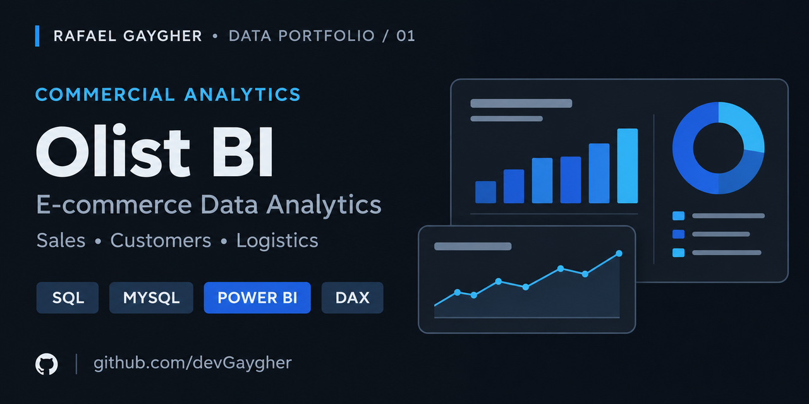
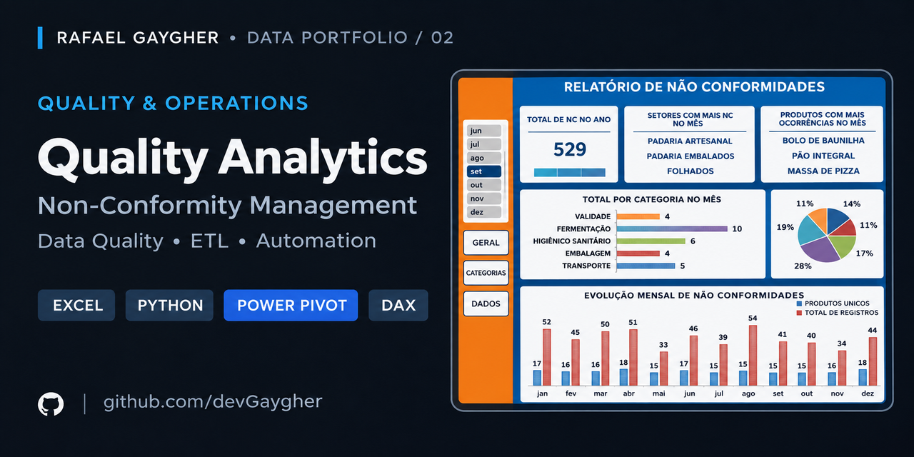
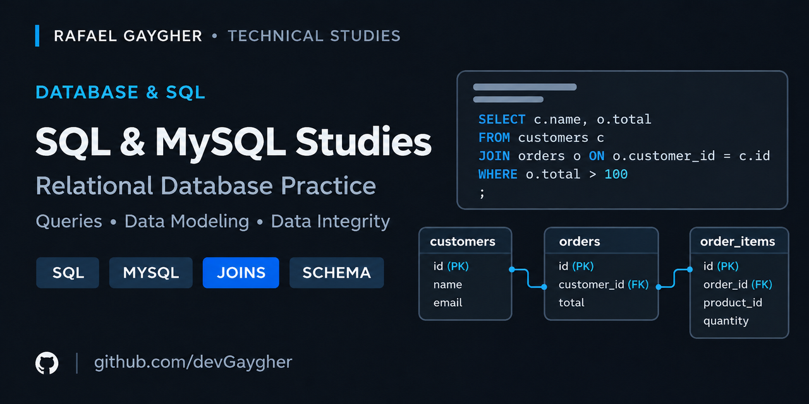

# 📊 Rafael Gaygher

**`Data Analyst | Business Intelligence | Data Quality`**

Olá! Sou Rafael, graduado em **Química Industrial** e graduando em **Tecnologia em Sistemas para Internet** pelo Instituto Federal do Espírito Santo (IFES).

Possuo experiência profissional em análise de indicadores operacionais, tratamento e validação de dados, desenvolvimento de dashboards gerenciais e melhoria contínua de processos.

Meu interesse pela área de dados surgiu durante minha atuação como Analista de Qualidade na indústria alimentícia, quando desenvolvi soluções para transformar registros operacionais em indicadores que apoiassem a tomada de decisões.

Atualmente, desenvolvo projetos de **Data Analytics e Business Intelligence**, aplicando conhecimentos em SQL, Python, Power BI, Excel, ETL e modelagem de dados para resolver problemas de negócio.

    
    

---

### 🚀 Projetos de Portfólio

#### 🛒 [Olist BI — E-commerce Data Analytics](https://github.com/devGaygher/olist-bi)

    

Projeto de análise de dados utilizando o dataset público de e-commerce brasileiro da Olist.

A solução contempla o tratamento, a validação, a modelagem e a análise de dados relacionados a vendas, clientes, logística e satisfação, com desenvolvimento de dashboards interativos para apoio à tomada de decisões.

**Principais competências aplicadas:**

- Data Profiling e qualidade de dados;
- ETL e tratamento de informações;
- Consultas SQL e MySQL;
- Modelagem dimensional em esquema estrela;
- Desenvolvimento de medidas DAX;
- Análise de indicadores de negócio;
- Dashboards interativos em Power BI;
- Documentação técnica.

**Stack:** SQL · MySQL · Power BI · DAX · Power Query

**[Acessar projeto completo →](https://github.com/devGaygher/olist-bi)**

---

#### 📊 [Quality Analytics — Non-Conformity Management](https://github.com/devGaygher/quality-analytics-dashboard)

    

Projeto de Business Intelligence desenvolvido originalmente para atender a uma necessidade real de controle e acompanhamento de indicadores de qualidade na indústria alimentícia.

A solução contempla a extração, o tratamento, a padronização e a validação de registros operacionais, além do desenvolvimento de dashboards interativos para monitoramento de não conformidades e apoio à tomada de decisões.

**Principais competências aplicadas:**

- Extração de dados do Trello;
- ETL e qualidade de dados;
- Automação com Python, Pandas e OpenPyXL;
- Tabelas dinâmicas e segmentações;
- Modelagem de dados com Power Pivot;
- Desenvolvimento de medidas DAX;
- Monitoramento de KPIs operacionais;
- Análise de Pareto;
- Testes unitários;
- Documentação técnica.

**Stack:** Excel · Python · Pandas · OpenPyXL · Power Pivot · DAX · Trello

> Projeto autorizado para divulgação profissional, utilizando uma base demonstrativa de 529 registros sintéticos.

**[Acessar projeto completo →](https://github.com/devGaygher/quality-analytics-dashboard)**

---

#### 💰 Corporate Financial Analytics — Brazilian Steel Industry

**Status:** 🚧 Em desenvolvimento

Projeto de análise econômico-financeira de empresas brasileiras de capital aberto, utilizando dados públicos oficiais da Comissão de Valores Mobiliários (CVM).

O objetivo é desenvolver um dashboard executivo de desempenho financeiro, permitindo comparar resultados, rentabilidade, liquidez, endividamento e geração de caixa.

**Escopo planejado:**

- Extração e tratamento de demonstrações financeiras;
- Automação de processos ETL;
- Validação e reconciliação contábil;
- Análise horizontal e vertical;
- Comparação de desempenho entre empresas;
- Indicadores financeiros como EBITDA, ROE, ROA e capital de giro;
- Dashboard executivo de página única.

**Stack planejada:** Python · Pandas · SQL · MySQL · Power BI · DAX

---

### 🛠️ Linguagens e Tecnologias

#### 🗄️ Linguagens e Bancos de Dados

    
    
    

#### 📊 Data Analytics e Business Intelligence

    
    
    
    
    
    
    

#### ⚙️ Versionamento e Gerenciamento de Projetos

    
    
    

#### 💻 Desenvolvimento Web

    
    

---

### 🧠 Competências Técnicas

| Área | Competências |
| :--- | :--- |
| **Data Analytics** | Análise exploratória, análise de tendências e identificação de padrões |
| **Data Quality** | Data Profiling, Data Cleaning, consistência, integridade e validação |
| **ETL** | Extração, transformação, padronização e carregamento de dados |
| **Data Modeling** | Modelagem relacional e dimensional (Star Schema) |
| **Business Intelligence** | Dashboards interativos, KPIs, DAX e relatórios gerenciais |
| **Automação** | Python, Pandas e OpenPyXL |
| **Business Analysis** | Análise de processos, indicadores operacionais e análise de Pareto |
| **Documentação** | Documentação técnica, regras de negócio e premissas analíticas |
| **Versionamento** | Git e GitHub |

---

### 🎓 Formação Acadêmica

- **Tecnologia em Sistemas para Internet** — IFES  
  2024 – Em andamento

- **Química Industrial** — IFES  
  Concluído

---

### 📚 Repositórios de Estudos

#### 🗄️ [SQL & MySQL Studies](https://github.com/devGaygher/mysql-sql-studies)

    

Repositório dedicado ao desenvolvimento e aprimoramento de conhecimentos em SQL e bancos de dados relacionais.

**Principais conteúdos:**

- Consultas SQL;
- JOINs e subqueries;
- CTEs e views;
- Modelagem de bancos de dados relacionais;
- Chaves primárias e estrangeiras;
- Restrições de integridade;
- Permissões de usuários;
- Estudos utilizando a base Sakila.

**Stack:** SQL · MySQL · Sakila

**[Acessar repositório de estudos →](https://github.com/devGaygher/mysql-sql-studies)**

---

### 📖 Aprendizado Contínuo

Atualmente, estou aprofundando meus conhecimentos em:

- SQL avançado e consultas analíticas;
- Python aplicado à análise e automação de dados;
- Pandas e tratamento de dados;
- Power BI e medidas DAX avançadas;
- Modelagem dimensional;
- Automação de pipelines ETL;
- Análise de indicadores financeiros e contábeis;
- Business Intelligence aplicado à indústria.

---

### 🎯 Interesses Profissionais

- Data Analytics
- Business Intelligence
- Data Quality
- Financial Analytics
- Industrial Analytics
- Business Analysis
- Process Automation
- Data Engineering

---

    Transformando dados em informações confiáveis para apoiar decisões de negócio.

